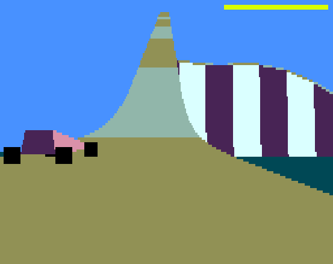

# Stunt Car Racer for the Uzebox

A port of the race logic of [*Stunt Car Racer Remake*](https://github.com/ptitSeb/stuntcarremake) (the PC remake of Geoff Crammond's
1989 game by ptitSeb) to the Uzebox by Dan MacDonald with the assistance of Claude Opus 5.5.



SCR is made possible on the Uzebox by two new components introduced by this game:

* **Uzebox video mode 19** (`videoMode19/`) - run-length-encoded scanlines: 256 x 110 pixels,
  256 colours, the CPU free during long runs. It's called 19 because S is the 19th letter of the
  alphabet and the first letter of both Stunt Car Racer and Sega. It was initially inspired by
  CunningFellow's RLE video mode.

* **Model S** (`modelS/`) - the polygon renderer and the scanline rasterizer that feed mode 19,
  named in tribute to Sega's Model series of arcade hardware which began with Model 1 and
  Virtua Racing.

## Requirements

Requires a Uzebox with at least **64 KB SPI RAM** and the **Uzebox bootloader 5.0.06 or later**.

### 128 KB or 64 KB SPI RAM?

The two chips are addressed differently: the 128 KB 23LC1024 takes a 24-bit address after each
command, the 64 KB 23LC512 a 16-bit one. A build sends one or the other on every transfer, and
its SPI RAM layout must fit the chip, so each size needs its own build. 128 KB is the default,
as most Uzeboxes have it; `SPIRAM=64` makes the 64 KB one.

The game itself needs only 64 KB (track data 21 KB, edge slots 4 KB, the edge stream, two
pictures of 16 KB). On a 64 KB chip every transfer is one byte shorter - the renderer, the
rasterizer and the video copy task make thousands per picture - so the 64 KB build runs about
**4% faster** (measured with an earlier build: 6.92 instead of 7.20 display frames per game
tick). Its pictures are identical. Which build to use is decided by the chip in the Uzebox: a
build for the other size does not run (in cuzebox-ex the `.uze` header's `spiram=` sets the
chip).

You should be able to run the 128 KB build on Uzeboxes with more SPI RAM when that becomes an option.

## Running

Copy `stuntcar.uze` (or `stunt64k.uze` for a 64 KB SPI RAM) to the root of your Uzebox SD card,
or load it in [**cuzebox-ex**](https://github.com/weber21w/cuzebox-ex).

If you see a red screen when trying to load SCR with cuzebox-ex then its because you have too many
files or directories in the same folder and SCR cannot find its track data. Copy the .uze file into
its own directory or into a dir shared with less files and it should run fine.

## Controls

* Left and right cursor keys = dpad (steering)
* Enter = Start (Start / pause / resume race)
* A = B button (accelerate)
* Q = Y button (brake)
* S = A button (boost)
* Space = Select (mute sound)

## Game interface

When you start the game you are presented with the track selection screen.
Pushing left or right chooses the track, their number is indicated by the row of brown squares
displayed on the track selection screen. One brown square = track #1 etc.

* In game HUD: red bar = damage, yellow bar = boost, violet squares = laps begun.

* Paused: two white bars in the middle of the screen. Muted: a white loudspeaker triangle with
  a red cross, bottom right.

* When the race is over you will see a large green (won) or red (lost) square for about four
  seconds before you are returned to the track selection screen.

* Start-up failures: solid **blue** screen = the SPI RAM failed a write/read test; solid **red**
  screen = SD card / FAT / bootloader problem, or no `.uze` with the track data in the card's
  root directory.

## Building

Building SCR requires avr-gcc 7.3 or later; 16.2 is recommended (the fastest: the release
builds use it).

```sh
# 1. Prepare the Uzebox kernel with the patch (registers video mode 19; sound buffer size)
git clone https://github.com/Uzebox/uzebox.git
cd uzebox && git checkout 384ceb3 && git apply ../stuntcar-uzebox/kernel/uzebox_kernel.patch && cd ..

# 2. Build packrom (packs the .hex into a .uze): version 1.6 or later
#    (the kernel above stays at 384ceb3)
git -C uzebox show origin/master:tools/packrom/packrom.cpp > packrom.cpp
g++ -O2 -o packrom packrom.cpp

# 3. Build the game (128 KB SPI RAM version)
cd stuntcar-uzebox/game
make KERNEL_DIR=../../uzebox/kernel                     # -> scr.hex
make uze KERNEL_DIR=../../uzebox/kernel PACKROM=../../packrom   # -> stuntcar.uze (with the track data)

# or build the 64 KB SPI RAM version
make clean
make SPIRAM=64 KERNEL_DIR=../../uzebox/kernel
make uze SPIRAM=64 KERNEL_DIR=../../uzebox/kernel PACKROM=../../packrom   # -> stunt64k.uze
```

`KERNEL_DIR` defaults to `../../uzebox/kernel`: in the layout above, `uzebox/` is next to
`stuntcar-uzebox/`. The game builds with `-DVIDEO_MODE=19`; the kernel finds `videoMode19/`
through the include path (`-I` the package root), so nothing has to be copied into the kernel
tree. Run `make clean` after changing any build option: make does not notice a changed `EXTRA`.

`make uze` appends the track data (`data/SCRTRK.BIN`) to the `.uze`: after packrom's header and
program, padding to a whole 512-byte sector, then the data's 41 sectors. The bootloader programs
only the program part (its size is in the header) and ignores the rest. At start-up the game
searches the SD card's root directory - the bootloader starts games from there only - for a
`.UZE` file larger than any game alone can be (the 512-byte header plus the 61,440 bytes below
the bootloader) and a whole number of sectors, reads its last 41 sectors and checks that they
begin with `SCR_DATA_SIG` (the data's first bytes, in `port/scr_trackdata.h`); another game's
appended data there, the search goes on. Its name does not matter; with several such files the
first is used (every version of the game holds the same data). No such file: the red start-up
screen.

**Flash limit.** The Makefile stops at 61,352 bytes (0xEFA8), not at the bootloader's 61,440:
a build whose initialized data - copied from the end of the image at start-up, the pictures'
SPI RAM addresses among it - reached 0xEFB8-0xEFDA lost it on an Uzebox Omega (a stable
picture for half a second, then a rolling one), while one ending at 0xEFA8 ran. This version:
61,346 bytes with avr-gcc 16.2.0 (61,318 for the 64 KB build), 61,016 with 7.3.0; 5.x no longer
fits.

The game is compiled with `-fno-gcse -fno-move-loop-invariants`, which make the AVR code ~1.2 KB
smaller at the same speed. With avr-gcc 15 or later the Makefile also adds `-mno-fuse-move`
(16.2's fuse-move pass crashes - an internal compiler error - on this code) and three size
flags, and leaves out the unrolled division.

## Build options (`make ... EXTRA="..."`)

| | |
|---|---|
| `TRACK=n` | the track first shown in the menu (0..7) |
| `EXTRA=-DAUTOPILOT` | scripted input, starts racing (emulator tests) |
| `EXTRA=-DDEBUG_STATS FLASH_LIMIT=65536` | boot stage, phase, counters and stack painting in RAM (too large for the bootloader: emulator only) |
| `SPIRAM=64` | the build for a 64 KB SPI RAM (23LC512), ~4% faster (see "128 KB or 64 KB SPI RAM") |
| `FAST=0` | the C edge setup that sorts on insertion (default `FAST=1`: edge lists sorted once per picture, edge setup in assembly) |
| `FASTDIV=1` / `0` | the fully unrolled 32/16 division (~300 bytes more, ~2% faster) or the compact one, its loop unrolled four times. Default: 1 with avr-gcc 7.x-14.x, 0 with 15+ (it does not fit) |
| `TRASM=0` | the vertex transform in C (~100 bytes more and ~1% slower than the default assembly) |
| `SDBASE=sdBase.o EXTRA=-DSCR_SDBASE` | SD loading without the v5 bootloader, from a `SCRTRK.BIN` (standard-capacity FAT16 cards; the emulator test runners) |

## Repository contents

| Folder | |
|---|---|
| `game/` | the main program (C), the C++ glue, fixed-address buffers, the video copy task (`scr_copy.S`), Makefile, `gameinfo.properties` |
| `videoMode19/` | Uzebox video mode 19 (`videoMode19.s`, `.h`, `.def.h`), in the kernel's layout |
| `modelS/` | Model S: `modelS_render.cpp/.h` (polygon renderer), `modelS_rast.S` (rasterizer), and in assembly `modelS_emit.S` (edge setup), `modelS_clip.S` (clipping), `modelS_emitclip.S` (clipped polygons to edges), `modelS_transform.S` (vertex transform), `modelS_loadrows.S` (track rows to the screen), `modelS_car.S` (the opponent's car) |
| `port/` | the remake's race logic (ported to integer arithmetic), track module, I/O, assembly helpers |
| `data/` | `SCRTRK.BIN` (the track data, appended to the `.uze`), its generator and sources |
| `kernel/uzebox_kernel.patch` | registers video mode 19 in the kernel's `defines.h`, and lets a game size the sound buffer |
| `tests/` | PC-vs-AVR logic test; `reference/`: comparison with the original remake |
| `tools/cuzebox/` | cycle-level test runners for cuzebox-ex (`runtest`, `prof`) |
| `tools/api/` | a client for the cuzebox-ex TCP API and a scripted driver |

## How it works

Per game tick (main program): controls -> physics (the remake's logic) -> Model S renderer
(edge lists into SPI RAM) -> Model S rasterizer (the whole picture as run-length rows into SPI
RAM, double-buffered).
Per display frame (background task in video mode 19's line interrupt): the shown picture's
rows are copied from SPI RAM into the 256-byte ring that mode 19 plays out, 256 x 110 pixels
(each row shown on two scanlines), 256 colours. Mode 19 resynchronises at every frame start.

Where the time goes (profiled racing on track 1, before the latest optimizations): video mode
19's interrupt ~39% of the CPU and the copy task ~10% - a fixed cost of the display - then
rendering ~39%, rasterizing ~7% and the physics ~5%.

Internal RAM (4 KB): ring 0x100, Model S workspace 0x200 (688 bytes, shared in turn by the
renderer, the rasterizer's edge pool and output row, and the SD loader), the renderer's row heads
0x4B0 (220 bytes, also the rasterizer's extra edge slots), data/bss from 0x58C, ~850 bytes of
stack. SPI RAM (128 KB build): track data 0x00000, edge slots 0x14000, edge stream 0x15000,
pictures 0x18000 / 0x1C000; 64 KB build: 0x0000, 0x6000, 0x7000, 0x8000 / 0xC000.

SPI RAM transfers (`port/scr_xram.S`): about 1,100 per game tick, ~7 bytes on average, so the
short ones (up to 32 bytes, nearly all) go in one transaction without the long path's
bookkeeping; longer ones in chunks of 32 (the copy task never waits long for the bus). The byte
loops overlap: each byte's transfer starts as soon as the previous one is in.

Sound: the engine note is a sawtooth loop written into the kernel's sample buffer; the remake's
effects (Grounded, OffRoad, Wreck, Smash, Creak, HitCar) replace it with noise loops for a few
ticks (one voice).

The crane comes when the car is stuck in front of a wall - a steep segment the road climbs,
in this piece or the next three: in one of Stepping Stones' or Draw Bridge's pits, or Big Ramp's
gaps (ramp, steep drop, road on the ground, steep wall up to the landing). Stuck: on the road,
the player holding accelerate or brake for about six seconds without the car reaching a new
piece - against the wall or bouncing off it. It then puts the car past the wall (never across
the finish line). The pieces with such a wall are recognized by their height profiles
(scr_track.cpp, wall_ids); away from them - sliding back down a steep climb, reversing for a
run-up - only the original's rules apply, and falling off the road gets the original's crane, on
the same piece (or the one after a pit).

Piece limits: at most 48 visible pieces are drawn - the nearest (the culling pass meets pieces in
track order, and used to drop the newest: on a track's second half, Roller Coaster's banked right
turn, the road under the car went missing). When the renderer runs out of regions (128) or edge
slots (440), or the rasterizer of active-edge slots (71), the next pictures draw fewer of the
farthest pieces, and recover them one by one.

Keeping video mode 19 fed: the copy task (`bg_task` in `game/scr_copy.S`, in the line interrupt)
moves the finished picture's rows from SPI RAM into the mode's 256-byte ring. If it falls
behind, the mode shows black lines (underruns) - on busy views, such as Roller Coaster's banked
corners, it used to. Now: the copy task reads consecutive rows in one SPI transaction, at the
bus's pace; every other SPI transfer holds the bus for at most 32 bytes (or one edge, in the
rasterizer), and a copy task that waited for the bus runs as soon as it is free; and a row keeps
at most scr_short_budget pixels in runs shorter than 28 - which the mode draws inside its
interrupt - beyond that, short runs are merged into blocks of 28 (modelS_rast.S, emitb). The
budget adapts (scr_game.c, draw_limit_adapt): full detail (254) while the mode keeps up; after
a picture with underruns 64, which kept 150 views around those corners free of them; then 8 more
after every 64 pictures without. So a striped wall keeps its stripes (the track 8 preview in the
menu), and entering a really busy stretch costs one picture with a few black lines.

The rasterizer's edge pool has 72 slots - 48 in the shared workspace and 24 in the renderer's
row heads (`scr_bucket`, 220 bytes), placed right after them in `scr_bufs.S`, free while a
picture is rasterized; slot 0 takes the edges that do not fit, so 71 edges can be active in a
row. If a picture still needs more (`rast_overflow` counts dropped edges; an unclosed region
would show as a bar to the right edge), the next pictures draw 6 fewer of the farthest track
pieces and recover one at a time.

Assembly routines run in the main program alongside video mode 19's interrupt: they must never
use r5 (the whole program is built with `-ffixed-r5`; saving and restoring it is not enough).
Their internal labels are assembler-local (`.L...`): only the entry points are symbols (the test
scripts find variables such as `done` by name).

In assembly, each bit-identical to the C it replaces (kept, and selectable, for the PC builds and
the tests): edge setup (`modelS_emit.S`), clipping (`modelS_clip.S`, `modelS_emitclip.S`), the
vertex transform (`modelS_transform.S`), loading a chunk of rows (`modelS_loadrows.S`), the track
rows (`port/scr_rows.S`) and the rotation coefficients (`port/scr_trig.S`) - both used by the
renderer and the physics - plus the camera transform, divisions, SPI RAM transfers and the video
copy task. Rendering a picture went from 1.48 M to 1.22 M cycles (the renderer alone, without
the opponent, measured with an earlier compiler).
`scr_vtx` is 11 bytes on the AVR (no padding): the assembly steps through its arrays that way.

**The opponent's car** is the remake's model (Car.cpp): a tapered body of six faces and four
wheels, 24 points, in the remake's colours, oriented by the opponent's three angles as the remake
places it (Rz Rx Ry, using the physics' own CalcYXZTrigCoefficients, whose coefficients are kept),
with back faces culled and the wheels drawn behind or in front of the body by depth. It costs ~4-5%
of the tick rate while the opponent is on screen. `EXTRA=-DSCR_OPP_RECT` draws the old rectangle.

packrom takes the `.uze` header from `gameinfo.properties`, including `spiram=2` (the SPI RAM
size in 64 KB banks) and `sd=fast` (the SD timing hint). For a `SPIRAM=64` build the Makefile
passes it a copy with `spiram=1`.

## Tests

```sh
cd tests
# PC and AVR builds of the race logic, bit-exact (needs tools/cuzebox/runtest, see below)
sh logic_pc_vs_avr.sh 0 3000        # -> "ticks 3000: first mismatch none, mismatching 0; ..."
sh rows_c_vs_asm.sh                 # -> "track n: ... corners, differing 0" (track rows: C vs scr_rows.S)

# the port vs the ORIGINAL remake's logic, tick for tick, all 8 tracks
cd reference
sh build_reference.sh               # clones the remake at commit 9f0f8e6, builds it headless
sh compare_with_original.sh 3000    # -> "track n: 3000 ticks, first difference: none"
```

The PC side of the logic test is built 32-bit: it needs `gcc-multilib` and `g++-multilib`.

`compare_with_original.sh` builds the port with `SCR_EXACT_SIN` and `SCR_EXACT_CURVE` (the
remake's sine table and its double-precision curve maths). The game itself keeps integer
versions of these (a smaller sine table with interpolation, integer atan/sqrt), which differ by
rounding and make the races drift apart slowly; everything else is identical.

The test runners: `sh tools/cuzebox/build.sh /path/to/cuzebox-ex-checkout` applies a small
profiling hook, builds cuzebox-ex headless and links `runtest` and `prof` (details in
`tools/cuzebox/README.txt`: `prof` records every instruction, video line and sound sample;
`SPIR_BANKS=1` gives them a 64 KB SPI RAM for `SPIRAM=64` builds). The hook is made for
cuzebox-ex commit bd55361 (26 October 2026); if a later version changes the code it patches,
`build.sh` stops with a message. The runners read the track data from a `SCRTRK.BIN` beside the
`.hex` (the SD loader they use, `SDBASE=sdBase.o`, has no `.uze` to search).

## Regenerating the track data

`data/SCRTRK.BIN` and `port/scr_trackdata.h` come from `data/gen_trackdata.py`:

```sh
cd data && python3 gen_trackdata.py source/orig_tracks.json source/Tracks
```

`source/orig_tracks.json` is dumped from the remake (`tests/reference/build/scr_dump`);
`source/Tracks/*.bin` are the remake's track files. Both regenerate byte-identically (the header
includes `SCR_DATA_SIG`, the data's first bytes, by which the game recognizes it in a `.uze`).

## Known limitations

* One sound voice: during an effect the engine note is silent.
* About 7 display frames per game tick while racing (the Amiga version ran at 6). Views of much
  of a track at once - Roller Coaster in particular - are the slowest.
* Flash: ~5 bytes free with avr-gcc 16.2.0 (~330 with 7.3.0), below the 61,352-byte limit.

## Credits and licensing

* *Stunt Car Racer*: Geoff Crammond / MicroStyle (1989). The track files in
  `data/source/Tracks` and the data derived from them are from the original game.
* The race logic in `port/` (`Car_Behaviour.cpp`, `Opponent_Behaviour.cpp`, `3D_Engine.cpp`,
  `Track` data handling) is derived from the *Stunt Car Racer Remake* source as published at
  https://github.com/ptitSeb/stuntcarremake (commit 9f0f8e6), as are the reference files in
  `tests/reference/src`.
* The Uzebox kernel and the original code in this game are licensed under the GNU GPL v3.0.
